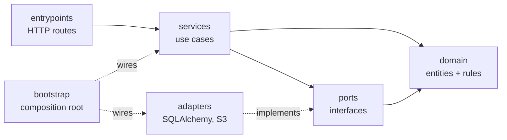

# Architecture

The backend is a layered (ports-and-adapters / hexagonal) application. This
document explains what each layer is for and how to decide where a piece of code
belongs. Read it once before writing anything; after that
[adding-a-feature.md](adding-a-feature.md) is the working reference.

## The one rule

**Dependencies point inward, toward the domain.**



Written as a table, where each layer may only import from the layers to its
right:

| Layer | May import |
|---|---|
| `domain` | nothing external — stdlib only |
| `ports` | `domain` |
| `services` | `domain`, `ports` |
| `adapters` | `domain`, `ports`, `config`, external SDKs |
| `entrypoints` | `domain`, `ports`, `services`, `config` |
| `bootstrap` | everything (it is the wiring) |

The rule is not a style preference — it is what buys the properties below. It is
enforced by `scripts/check_dependency_rule.py`, which runs in `make lint` and in
CI and reports the exact file and line.

**What the rule buys you.** The domain has no database, so its tests run in
milliseconds and you can afford thousands of them. Services depend on interfaces,
so they run against in-memory fakes and a full service suite finishes in under a
second. Swapping Postgres for something else, or S3 for GCS, touches one adapter
and `bootstrap.py` — not every service that happened to use it.

**The violation to watch for** is a service importing an adapter, usually because
it is quicker in the moment. The cost arrives later: that service can no longer
be tested without a real database, so it stops being tested, so its logic drifts.
If a service needs something external, it needs a *port* for it.

---

## The layers

### `domain/` — what the app is about

Plain Python classes holding the business rules. No SQLAlchemy, no Pydantic, no
FastAPI, no `datetime.now()`.

Rules live **on the entity**, not in the service:

```python
# domain/note.py — the rule is here
def archive(self, now: datetime) -> None:
    if self.is_archived:
        raise NoteAlreadyArchived
    self.archived_at = now
```

so that it holds no matter which service, CLI command or background job calls it.
A service that reads `if note.archived_at is not None: raise ...` has taken a
rule out of the domain, and the next caller will forget to repeat it.

Time is passed in as an argument rather than read, because a rule that calls
`datetime.now()` internally cannot be tested at a specific moment.

> **Anemic domain model** is the name for entities that are just bags of data
> with all the logic in services. It is the most common way this architecture
> gets hollowed out while keeping its folder structure.

### `ports/` — the shape of the hole

Abstract base classes describing what the app needs from the outside world.
`NoteRepository` says "something that can store and retrieve notes"; it says
nothing about SQL.

Repositories are collection-shaped — `add()`, `get()`, `list()`, not `insert()`
and `select()` — and there is **one per aggregate root, not one per table**. A
note's comments would belong to `NoteRepository`, because you never want a
comment handed to you detached from its note.

### `adapters/` — the plug that fits the hole

Concrete implementations. Every port has at least two: the real one and a fake
for tests.

```
ports/repositories.py          NoteRepository (ABC)
  adapters/repositories/note.py    SqlAlchemyNoteRepository
  adapters/repositories/fakes.py   FakeNoteRepository
```

The fake is a real working implementation backed by a dict, **not a mock**. Tests
assert on the state it ends up in, never on which methods were called — which is
why they survive refactoring. The contract binds both: if the real `list()` is
newest-first, the fake must be too, or green service tests will hide a real bug.
The integration tests exist precisely to check the two agree.

Adapters are not only for databases. `ObjectStorage` (S3) is one, and auth, LLMs,
notifications and payments all take the identical shape — see [blocks.md](blocks.md).

### `services/` — one method per use case

The orchestration layer. Every method is the same three beats:

```
load  →  delegate to the domain  →  save
```

Services own the clock, the transaction boundary, and "does this exist?"
decisions. They do not own business rules. A service takes a `UnitOfWork` (a
port), never a session and never a concrete repository.

### Unit of Work — the transaction boundary

One logical operation is one commit or one rollback. The UoW groups every
repository and owns that boundary, so a use case touching three repositories
still lands atomically:

```python
async with self._uow as uow:
    note = await uow.notes.get(note_id)
    note.archive(now=_now())
    await uow.commit()
```

Committing is always explicit. Forgetting loses the write, which is the safe
direction to fail in. `FakeUnitOfWork` exposes a `committed` flag so a test can
catch a service that mutates and forgets.

### `entrypoints/` — the edges

HTTP routes, request/response schemas, middleware. Routes are thin: parse input,
call one service method, shape the response. No `if`, no loop, no business
vocabulary. A route that grows a decision is holding logic that belongs in a
service or on an entity.

Domain errors are **not** caught here. `exception_handlers.py` maps the three
base classes to status codes once, for the whole app:

| Domain base class | HTTP |
|---|---|
| `NotFoundError` | 404 |
| `ConflictError` | 409 |
| `ValidationError` | 422 |

A new domain error added a year from now gets the right status automatically as
long as it subclasses one of them.

### `bootstrap.py` — the composition root

The one file that knows which concrete adapter is which. Everything else depends
on ports. Two lifetimes live here deliberately: process-wide singletons (an S3
client holds a connection pool) and request-scoped objects (a transaction must
not outlive its request).

---

## The three kinds of "model"

The subtlest mistake in this codebase is conflating these. They look alike today
and diverge tomorrow.

| File | Represents | Changes when |
|---|---|---|
| `domain/note.py` | the business entity | a business rule changes |
| `adapters/orm/tables.py` | the database row | you add an index or a column |
| `entrypoints/api/schemas/notes.py` | the JSON on the wire | an API consumer needs a different shape |

The domain entity is a plain dataclass; `tables.py` maps a table *onto* it
(imperative mapping). That is what keeps the domain free of SQLAlchemy. The cost
is writing columns out by hand; the return is a domain you can unit-test with no
database and carry across an ORM change.

---

## Frontend state: two stores, one rule

| Use | For |
|---|---|
| **TanStack Query** | anything the server owns. Fetched, cached, invalidated, can go stale |
| **Zustand** | anything only this browser tab knows. Open modals, filters, drafts |

**Never copy server data into Zustand.** That creates two sources of truth which
disagree after the first mutation, and every subsequent bug is a cache bug. If it
came from the server, read it from Query.

---

## When *not* to follow this

This is the destination shape, and the template starts you there because the
alternative — retrofitting layers onto a grown app — is far more expensive. But
match rigour to what you are building:

- **A genuinely small tool** (one table, no rules, no second consumer) does not
  need a domain layer. Routes calling SQLAlchemy directly is fine, and honest.
- **Don't add a port with only one implementation** unless you can name the real
  second one. `FakeXRepository` for tests counts. "We might swap this one day"
  does not — that is a speculative abstraction, and it costs indirection now for
  a future that usually never arrives.
- **Don't split `domain`, `orm` and `schema` for an entity with three fields and
  no rules.** Start merged, split when they first want to differ.

The dependency rule is the part that is always worth keeping. The folder count is
negotiable.
